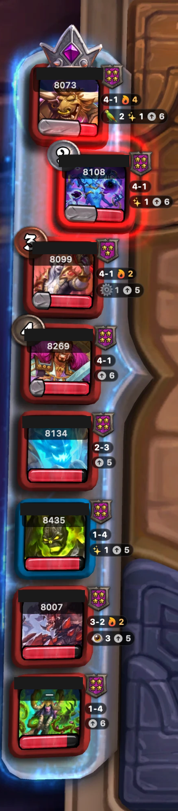
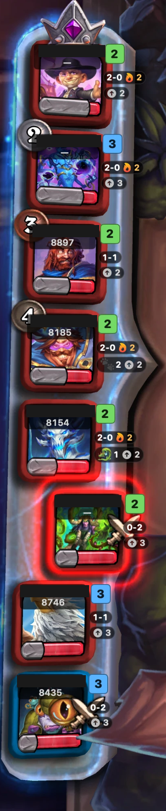
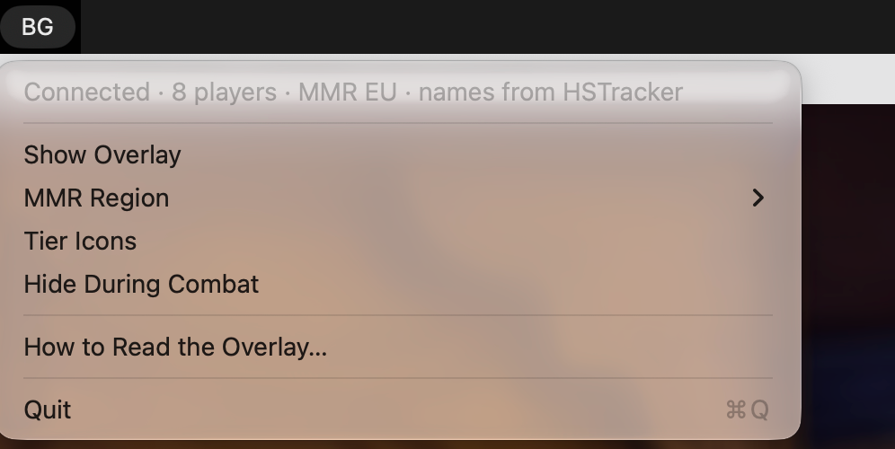

# HSBG Mac Overlay

A free macOS overlay for Hearthstone Battlegrounds. It labels every leaderboard portrait with the player's MMR, tavern tier, combat record, streak, triples, main tribe and levelling pace. It runs alongside [HSTracker](https://hsdecktracker.net/hstracker/), which doesn't show these on the leaderboard.

Battlegrounds **Solo** only, macOS only. Not affiliated with Blizzard Entertainment or HearthSim.

> **Use at your own risk.** This app reads Hearthstone's memory through HSTracker's HearthMirror component, loaded from `/Applications/HSTracker.app`, and is signed with the `com.apple.security.cs.debugger` entitlement to do so. Blizzard's Terms of Use prohibit unauthorized third-party programs that read game data; Blizzard has historically tolerated deck trackers, but that is not a guarantee, and your account is your responsibility. The app never injects code, automates input, or changes game files. See [Data sources and risk](#data-sources-and-risk).

<p align="center">
  
  &nbsp;&nbsp;
  
</p>
<p align="center"><sub>Tier shields (left) or colored tier numbers (right). Player names are hidden in these screenshots.</sub></p>

## Reading the overlay

The same guide is in the app: menu bar **BG → How to Read the Overlay…**

| Label | Meaning |
|---|---|
| Name over number | Player name and rating from the public leaderboard. **—** means no public rating: usually below 8,000 (only the top of each region is published), sometimes a recent rename or a name shared by two leaderboard players. |
| Shield or colored number | Tavern tier. Shields show stars; numbers are grey 1, green 2, blue 3, purple 4, orange 5, red 6. |
| `10-1` | Rounds not lost, then rounds lost. Ties count as not lost (nobody takes damage, so the log cannot tell them from wins). |
| Flame `4` | 2 or more rounds in a row without losing. |
| Tribe icon `5` (e.g. 🐉 5) | Main tribe on their board the last time you fought them, and how many; a second tribe shows at 3 or more. Faded when more than 2 turns old. |
| Sparkles `2` | Triples made this game. |
| Up arrow `9` | Turn they reached their current tier; low means fast levelling. |
| Pushed-out portrait | Your next opponent; labels move with it. |

Tribe icons: 🦁 Beast · 😈 Demon · 🐉 Dragon · 🌪️ Elemental · ⚙️ Mech · 🐟 Murloc · 🐍 Naga · 🦜 Pirate · 🐗 Quilboar · 💀 Undead · 👁️ Aberration · 🌈 Amalgam (every tribe).

Menu options: **Tier Icons** (shields or numbers), **Hide During Combat** (labels follow the fight animation, so showing them is safe), **MMR Region** (EU, US or AP; remembered). The first menu line shows what the overlay currently sees, which helps when nothing appears.

<p align="center"></p>

## Requirements

- macOS 13 or later
- Xcode 16 or later (Swift 6 tools) to build
- [HSTracker](https://hsdecktracker.net/hstracker/) installed at `/Applications/HSTracker.app`, for player names and tier shields. Without it the overlay still shows tiers (as numbers), records, streaks, triples and tribes, but no names or MMR.
- Hearthstone writing verbose Power logs (below)

### Enable Power logging

Create or edit `~/Library/Preferences/Blizzard/Hearthstone/log.config` so it contains:

```
[Power]
LogLevel=1
FilePrinting=true
ConsolePrinting=false
Verbose=true
```

Then restart Hearthstone. Logs are written to `/Applications/Hearthstone/Logs`. If you already use HSTracker, this is usually set up.

## Build and install

There is no prebuilt download yet; build it from source.

```bash
swift build
swift test
```

Build a Finder-launchable app bundle (ad-hoc signed with the debugger entitlement) into `dist/`:

```bash
sh scripts/package-app.sh
```

Or install it to `~/Applications` and start it at login (it shows the overlay whenever Hearthstone is open):

```bash
sh scripts/install-autostart.sh
```

The app lives in the menu bar as **BG**; it has no window or Dock icon. `swift run HSBGMacOverlay` also works for development, but that binary lacks the debugger entitlement, so it runs on the log alone (no names or MMR).

### Uninstall

```bash
launchctl bootout gui/$(id -u)/com.dylanbuchi.hsbg-mac-overlay
```

Then delete `~/Library/LaunchAgents/com.dylanbuchi.hsbg-mac-overlay.plist`, `~/Applications/HSBG Mac Overlay.app` and `~/Library/Logs/HSBGMacOverlay*.log`.

## Data sources and risk

1. **`Power.log` (read-only).** Leaderboard places, heroes, tavern tiers, triples, health changes, the next opponent and the boards you fight. Board state is read from playback (`PowerTaskList`) lines so it changes with the animation; game type, names and game boundaries come from `GameState` lines.
2. **HearthMirror (reads game memory).** `HearthMirrorBridge` loads the framework from `/Applications/HSTracker.app` at runtime and attaches to the Hearthstone process to read the lobby (player names). It runs about once a second while Hearthstone is open and a Power.log exists. HearthMirror is not bundled; without HSTracker at that path, the overlay uses the log only.
3. **bgrank.fly.dev (network).** An unofficial third-party mirror of Blizzard's public Battlegrounds leaderboard. The app downloads the list for your region (EU by default) at most every 15 minutes and matches names locally; it sends nothing about you or your opponents.

Tavern tier shields are also read at runtime from the HSTracker app bundle. This repository contains no Blizzard assets and no HearthSim binaries.

## Known limits

- Solo only: in Duos the overlay shows nothing (the menu says so).
- Tribes use each minion's main race only (the log carries one per minion), and exist only for players you have fought.
- MMR results live only in memory and refresh every 15 minutes.

## License

MIT, see [LICENSE](LICENSE). The leaderboard geometry is derived from HSTracker (MIT, © HearthSim); see [THIRD_PARTY_NOTICES.md](THIRD_PARTY_NOTICES.md). Hearthstone is © Blizzard Entertainment.
