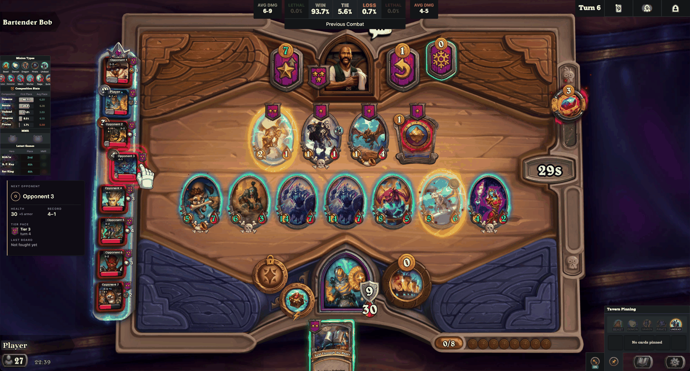
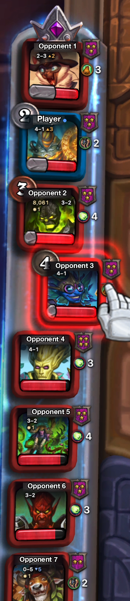
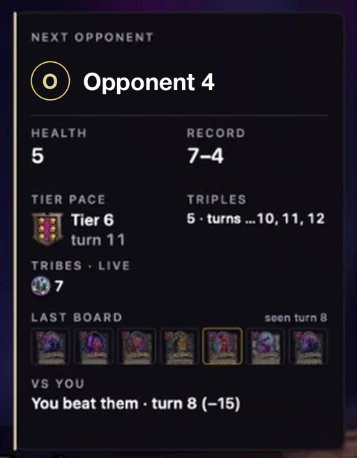
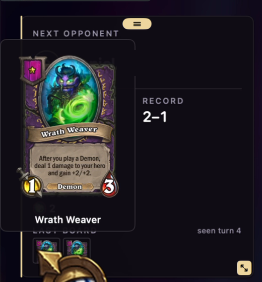

# HSBG Mac Overlay

[](https://github.com/dylanbuchi/hsbg-mac-overlay/actions/workflows/ci.yml)

A free macOS overlay for Hearthstone Battlegrounds. It labels every leaderboard portrait with the player's name, MMR, tavern tier, combat record and streak, and shows a full card for your next opponent (tier pace, last board, triples). It runs alongside [HSTracker](https://github.com/HearthSim/HSTracker), which doesn't show these on the leaderboard.

Battlegrounds **Solo** only, macOS only. Not affiliated with Blizzard Entertainment or HearthSim.

> **Use at your own risk.** This app reads Hearthstone's memory through HSTracker's HearthMirror component, loaded from your HSTracker installation (found by its bundle id, `/Applications/HSTracker.app` by default), and is signed with the `com.apple.security.cs.debugger` entitlement to do so. Blizzard's Terms of Use prohibit unauthorized third-party programs that read game data; Blizzard has historically tolerated deck trackers, but that is not a guarantee, and your account is your responsibility. The app never injects code, automates input, or changes game files. It leans on HearthMirror's internals, so a Hearthstone or HSTracker update can make it stop reading names or tribes, or crash; it then fails closed to the log alone. See [Privacy](#privacy) and [Data sources and risk](#data-sources-and-risk).

<p align="center">
  
</p>
<p align="center"><sub>A shop turn: labels on every leaderboard portrait, and the NEXT OPPONENT card on the left under HSTracker's panel.</sub></p>

<p align="center">
  
  &nbsp;&nbsp;
  
  &nbsp;&nbsp;
  
</p>
<p align="center"><sub>Left: the leaderboard labels (record, ▲/▼ streak, gold disc for triples, tier shield, main tribe and count). Middle: the NEXT OPPONENT card before you have fought them. Right: pointing at a minion in the last board shows it larger; the gold grip and corner move and resize the card.</sub></p>

## Reading the overlay

The same guide is in the app: menu bar **BG → How to Read the Overlay…**

| Label | Meaning |
|---|---|
| Name, then MMR | Player name (starting after the game's own rank medal), and under it their rating from the public leaderboard (gold). No MMR under the name means no public rating: usually below 8,000 (only the top of each region is published), sometimes a recent rename or a name shared by two leaderboard players. The brighter, bolder gold MMR is the single highest rating in the lobby (nobody gets it on a tie); a small blue dot after the name is you. |
| `10-1` | Rounds not lost, then rounds lost. Ties count as not lost (nobody takes damage, so the log cannot tell them from wins). |
| ▲ 4 / ▼ 3 | 2 or more rounds in a row **not lost** (▲, amber) or **lost** (▼, blue), and how many. The arrow says which, so colour is never the only clue. |
| Round icon + number | Under the tier shield: their main tribe (the round tribe picture HSTracker's own panel uses, read from your HSTracker install, else our own simple drawn icon per tribe: Beast, Demon, Dragon, Elemental, Mech, Murloc, Naga, Pirate, Quilboar, Undead, Aberration; Amalgam counts for every tribe) and how many minions of it on the last board you saw them play. With live data it is the leading tribe right now; otherwise it comes from the last board you saw, a second tribe shows at 3 or more, and it fades when that board is more than 2 turns old. |
| Shield or colored number | Tavern tier. Shields show stars; numbers are grey 1, green 2, blue 3, purple 4, orange 5, red 6. |
| Gold disc + 2 | Triples made this game (here, 2), under the MMR; shown once they have at least one. |

The label is a soft dark fade with outlined type over the top of the portrait, and scales with the window. On small windows it drops the record first, then the streak, so name and MMR always stay readable.

### Next opponent card

During the shop phase, a **NEXT OPPONENT** card sits on the left, under HSTracker's panel (the overlay finds HSTracker's window by its position and size only; it never reads its title or contents, so no screen-recording permission is needed). HSTracker usually draws its panel inside one big transparent window, whose real bottom edge cannot be measured from outside; in that case (the usual one) the card rests on the bottom of the game window (8 % margin) and grows upward, never above 62 % of the height, which clears a "Latest Games" list of up to 10 rows. The card shrinks to fit above the bottom edge, and is hidden if there is no room at all. It shows:

- their name, MMR and rank among the listed players of the lobby (`#2 of 5 listed`). When the app has an older leaderboard list from the last 24 hours (at least 1 hour old), the MMR is followed by the change, `▲45` green or `▼89` red, and the window (`since 6 h`); nothing is shown without such a list or for unlisted players. The rank is left out if the line would not fit;
- record and streak (▲ not lost / ▼ lost);
- tier pace: the tier they are at and the turn they reached it (the tier shield and `on turn 8`); after a reconnect the turns of earlier tiers and triples are not known, so only the tier shows;
- tribes: their top three minion types with at least 2 minions each (a single minion of a type is left out, as on the portraits), labelled `live` (the game's own leaderboard hover data, see the data sources) or, when that is unavailable, `seen turn N` (their board in your last fight). The two are never mixed. Live counts can exceed a board's size because two-tribe minions count for both tribes (Amalgams count for every tribe): read them as "most of". The leading live tribe also sits under each portrait's tier shield;
- last board: once you have fought them, a row of their minions as they stood in that combat, left to right, with a small `seen turn 7` (the game turn of that fight; faded when more than 2 turns old). Minion art comes from hsbg.cards (see the data sources); without it a text chip with the name is shown. Point the mouse at one minion for a moment and a larger copy of it, with its name, appears just above that minion (below it when there is no room above), so it never covers the player names (Settings > "Zoom minions on hover", on by default). It only watches where the mouse is (no extra macOS permission), never takes clicks or focus from the game, and reuses the image already downloaded, so there is no extra request;
- health: what they have left (maximum health minus damage; **armor is shown apart**, `+4 armor`, as the game does) and, when known, the points of health and armor they lost in their last combat (`down 9`). Damage they dealt to others is not known and not shown;
- triples, only once they have made one, with the turns they were seen happening (the last three, e.g. `2 · turns 7, 12`); a triple the overlay did not see happen (read late) adds no turn;
- versus you, only once you have fought them: the latest fight each way, `Beat you · turn 5 (−9)` and `You beat them · turn 9 (−12)`. The number is what the loser lost, read from the loser's own hero; draws are not listed.

A **—** means unknown (never a guess): for example no MMR when they are not on the public leaderboard. Before you have fought them the last board reads `Not fought yet`. There is one card at a time. It hides during combat, after the last fight and when the game names no next opponent.

Menu options: **Tier Icons** (shields or numbers), **Show Overlay During Combat** (off by default; labels follow the fight animation, so showing them is safe), **Show Next Opponent During Combat**, **Move Card…** (point at the NEXT OPPONENT card and a gold grip and corner appear: drag the grip to move it anywhere over the game, the corner to resize it; only the two handles take clicks. Move Card… does the same from the menu. Saved per window shape, kept inside the window, and **Reset Card Position** goes back to automatic), **MMR Region** (EU, US or AP; remembered). At the bottom: **Settings…** (⌘,), **About HSBG Mac Overlay** and the version. The first menu line shows what the overlay currently sees, which helps when nothing appears. Below it, once ratings are known, a second line summarizes the lobby, for example `Lobby avg 9.4k · you #3 of 5 listed · 3 unlisted`: the average of the players who have a public rating, your rank among them, and how many players have none (unlisted players are counted, never guessed; if you are unlisted it says so).

<p align="center"></p>

## Requirements

- macOS 13 or later. Apple silicon for live opponent tribes (read from game memory); the rest also runs on Intel
- [HSTracker](https://github.com/HearthSim/HSTracker) installed (anywhere macOS can find it; `/Applications` is the default), for player names and tier shields. Without it the overlay still shows tiers (as numbers), records, streaks and the next-opponent card, but opponents' names, and so their MMR, are missing (the log only names you).
- Hearthstone writing verbose Power logs (below)

### Enable Power logging

Create or edit `~/Library/Preferences/Blizzard/Hearthstone/log.config` so it contains:

```
[Power]
LogLevel=1
FilePrinting=true
ConsolePrinting=false
Verbose=true
```

Or open the **BG** menu and choose **Turn On Power Logging…**, which makes this change for you (the old file is kept as `log.config.bak`; the item only shows when logging is not already on). Then restart Hearthstone. Logs are written to the `Logs` folder next to `Hearthstone.app` (`/Applications/Hearthstone/Logs` by default). If you already use HSTracker, this is usually set up.

## Install

1. Download `HSBG-Mac-Overlay.zip` from the [latest release](https://github.com/dylanbuchi/hsbg-mac-overlay/releases/latest). It is built by GitHub Actions from the tagged source ([workflow](.github/workflows/release.yml)).
2. Unzip it and move **HSBG Mac Overlay** to your Applications folder.
3. Open it. The app is free and not notarized by Apple, so macOS blocks the first launch: click **Done**, then open **System Settings → Privacy & Security**, scroll down and click **Open Anyway** next to HSBG Mac Overlay. On macOS 13 or 14 you can instead right-click the app and choose **Open**. This is needed only once. Terminal alternative: `xattr -dr com.apple.quarantine "/Applications/HSBG Mac Overlay.app"`.

The app appears in the menu bar as **BG**; it has no window or Dock icon. The first launch opens the "How to Read the Overlay" guide so you know it is running. macOS may ask for permission ("Developer Tools Access") the first time the app reads names from Hearthstone; on a standard (non-admin) account it can ask for an administrator password. Declining keeps the overlay working from the log alone. To start it automatically, add it in **System Settings → General → Login Items**.

### Verify the download

Releases carry a build provenance attestation made by GitHub Actions. The commands look for the files in the current folder, so first go to where you saved them (for example the Downloads folder). With the [GitHub CLI](https://cli.github.com/):

```bash
cd ~/Downloads
gh attestation verify HSBG-Mac-Overlay.zip --owner dylanbuchi
```

## Troubleshooting

The first line of the **BG** menu says what the overlay sees.

| Status | What to do |
|---|---|
| No Power.log yet | Power logging is off. Choose **Turn On Power Logging…** in the BG menu (or edit `log.config` as above), then restart Hearthstone. |
| Reading Power.log… NN% | Normal after a long session: the log is read in pieces. It finishes by itself. |
| Log connected · waiting for a Battlegrounds Solo match | Working. Start a Solo match. |
| Duos is not supported yet | Duos is not supported; play Solo. |
| no player names: HSTracker's game reader did not load | Install [HSTracker](https://github.com/HearthSim/HSTracker). The overlay still works from the log, without opponent names or MMR. |
| no player names: install HSTracker (the official HearthSim app) | The app only loads HearthMirror from HearthSim's signed HSTracker. Reinstall the official release; self-built copies are refused. |
| no player names: macOS did not allow reading the game | macOS refused access to Hearthstone. Allow the macOS prompt if one appears, then reopen the overlay. |
| MMR offline, retrying | No leaderboard source could be reached and there is no recent cache; it retries every 30 s to 2 min by itself. |
| MMR … via cache, NN min old | Every source failed, so the last saved list (under 6 hours old) is used; live sources are retried automatically. |
| Reading the game stalled | The reader is stuck. Quit and reopen the overlay. |

If nothing helps, open an issue and paste the first line of the menu, plus the version (the **BG** menu shows it at the bottom, and **About HSBG Mac Overlay** opens the standard About panel).

## Build from source

Requires Xcode 16 or later (Swift 6 tools).

```bash
swift build
swift test
```

Build a Finder-launchable app bundle (ad-hoc signed with the debugger entitlement) into `dist/`:

```bash
sh scripts/package-app.sh
```

Or install it to `~/Applications` and start it at login (it shows the overlay whenever Hearthstone is open):

```bash
sh scripts/install-autostart.sh
```

`swift run HSBGMacOverlay` also works for development, but that binary lacks the debugger entitlement, so it runs on the log alone (no opponent names or MMR).

### Releasing

1. Write `docs/release-notes-<version>.md` (a `# title`, the sections users read, and a final `## Verify the download` section, which the release page replaces with its own note). Without this file the release job stops before building.
2. Set the version in `packaging/Info.plist` and date its CHANGELOG entry.
3. Run `swift test`, push `main`, and wait for CI to pass on that commit.
4. Tag that commit and push the tag: `git tag v<version> && git push origin v<version>`. The tag must equal `v` + the Info.plist version, or the release job fails.

`sh scripts/release-notes.sh <version>` prints the release body locally.

### Uninstall

If you downloaded the app, quit it from the **BG** menu, remove it from Login Items if you added it, and delete it from Applications. If you used `install-autostart.sh`:

```bash
launchctl bootout gui/$(id -u)/com.dylanbuchi.hsbg-mac-overlay
```

Run `defaults delete com.dylanbuchi.hsbg-mac-overlay` to clear its preferences. Then delete `~/Library/LaunchAgents/com.dylanbuchi.hsbg-mac-overlay.plist`, `~/Applications/HSBG Mac Overlay.app`, `~/Library/Application Support/HSBGMacOverlay` (the ratings cache) and `~/Library/Logs/HSBGMacOverlay*.log`.

## Privacy

- **Game memory, read only.** Through HSTracker's HearthMirror the app reads the lobby (each player's name, hero and account id, used only to put players in leaderboard order) and, for live tribes, the game's leaderboard tiles (hero entity id and minion type counts). Nothing else: no hands, decks or hidden information. These values stay in memory: never saved to disk, never sent anywhere.
- **Network: four hosts, all https, no player data.** The leaderboard lists from `bgrank.fly.dev`, then a GitHub mirror on `raw.githubusercontent.com`; the release check on `api.github.com`; and `hsbg.cards` for tier badges and minion art (looked up by card name). Like any web request they see your IP address and the app's name and version.
- **On disk:** the last leaderboard list and rating snapshots, tier badges and minion art in `~/Library/Application Support/HSBGMacOverlay/`, and your settings.

## Data sources and risk

1. **`Power.log` (read-only).** Leaderboard places, heroes, tavern tiers, triples, health changes, the next opponent and the boards you fight. Board state is read from playback (`PowerTaskList`) lines so it changes with the animation; game type, names and game boundaries come from `GameState` lines.
2. **HearthMirror (reads game memory).** `HearthMirrorBridge` loads the framework from the installed HSTracker at runtime, after checking that the app is HearthSim's signed build, and attaches to the Hearthstone process to read the lobby (player names). It runs about once a second while Hearthstone is open and a Power.log exists. HearthMirror is not bundled; without HSTracker, the overlay uses the log only.
   **Live opponent tribes (Settings > "Read opponent tribes from game memory", on by default).** In a Battlegrounds Solo match, about every 3 seconds, the app reads the same per-player minion type counts the game itself shows when you hover a leaderboard portrait (`PlayerLeaderboardManager`'s tiles: hero entity id and race counts), through the Mono reader that HearthMirror already exposes. It only reads: no writes to the game or to HSTracker, no injection, no suspending the process, nothing that is not already on your screen (no hands, decks or hidden information). It leans on HearthMirror's private internals and on the game's class and field names, so a game update or an HSTracker update can break it without notice; the overlay then falls back to the board you last saw (labelled `seen turn N`) and the status line says why. It needs Apple silicon and HSTracker installed. Turn the setting off to stop all of it; the lobby names above are a separate read.
3. **Leaderboard lists (network).** Public copies of Blizzard's Battlegrounds leaderboard, tried in order: [bgrank.fly.dev](https://bgrank.fly.dev) (an unofficial mirror), then a GitHub mirror of the same list ([bg-board-mirror](https://github.com/lowerman/bg-board-mirror), refreshed about every 30 minutes). The app downloads the list for your region (EU by default) when a new game starts (at most every 2 minutes) and every 15 minutes during a game, and matches names locally; after a failure it retries after 30 s, 60 s, then every 2 minutes. A source that is down, answers with an error or returns too few rows is skipped. The last good list is kept in `~/Library/Application Support/HSBGMacOverlay/` and used only when every source fails; it expires after 6 hours and is validated on load. Each successful download is also kept as a compact snapshot (names and ratings, at most one per 30 minutes, thinned and dropped after 36 hours, under 12 MB) in `rating-history-<region>.json` next to it, only to show rating changes on the card. The status line says which source (or the cache) is in use. Each request is a plain download: like any web request it reveals your IP address and the app's name and version to that server, but it contains no player names or game data. Blizzard's own leaderboard API is not used: it serves 25 players per ~300 KB page, about 300 pages for EU, which is too heavy to poll politely.
4. **GitHub releases (network).** At launch the app makes one anonymous request to `api.github.com` for the latest release of this repository. If a newer version exists, the BG menu gets a "New Version Available" item that opens the release page. Nothing about you or the game is sent beyond what any web request reveals (IP address, app name and version); offline or on any error it stays silent. You can turn it off in Settings (BG menu > Settings…).

5. **Tavern tier badges on the NEXT OPPONENT card (network).** The card shows the game's tier badge. The six images (`Tier1.png` to `Tier6.png`) are downloaded once from [hsbg.cards](https://hsbg.cards/tiers/Tier1.png) the first time a tier is needed (one plain GET each, 8 s timeout, no retry loop) and cached in `~/Library/Application Support/HSBGMacOverlay/tier-images/`; the app asks the server again at most once a day. Images must be real PNGs under 200 KB. Offline or on any error, a drawn badge is used instead. Like any web request, this lets hsbg.cards see your IP address and the app's name and version, nothing else. The images are Blizzard artwork and are not part of this repository or the app. Card data and images courtesy of HS BG Cards; not affiliated with Blizzard.
6. **Minion art on the NEXT OPPONENT card (network).** Once you have fought the next opponent, the card shows their last board as a row of small minion cards. For a board the app makes one lookup on [hsbg.cards](https://hsbg.cards/api/v1/cards) by card name (names only, never player names or game data), then one GET per missing image (8 s timeout, at most 30 requests a minute, `Retry-After` honoured, no retry for 10 minutes after a failure) and keeps the images in `~/Library/Application Support/HSBGMacOverlay/card-art/` (WebP or PNG under 150 KB, at most 300 files, refreshed after 14 days). Nothing is downloaded ahead of time: only the minions on the board shown. Offline, on any error or without art, a small text chip with the minion's name is shown instead. Like any web request, this lets hsbg.cards see your IP address and the app's name and version. The art is Blizzard artwork rendered by HS BG Cards; it is not part of this repository or the app. Card data and images courtesy of [HS BG Cards](https://hsbg.cards); not affiliated with Blizzard.

Tavern tier shields and the round tribe pictures (`tribe_beast` and the other eleven, from HSTracker's asset catalog) are also read at runtime from the HSTracker app bundle, the pictures only after checking that the app is HearthSim's signed build; they are only displayed, never copied, extracted or saved by this app. If HSTracker or a picture is missing, the drawn icon is used. This repository contains no Blizzard assets and no HearthSim binaries.

## What the overlay shows, and policy

It shows only what a player can also see in the game or on the public leaderboard: names, tavern tiers, boards you fought, triples, and a record derived from watching combats. It never automates input or changes game files. Blizzard's policy can change, and features will be removed if they ask.

## Known limits

- Solo only: in Duos the overlay shows nothing (the menu says so).
- Live tribes need Apple silicon, HSTracker and the memory setting on. Without them, tribes come from the log: each minion's main race only, and only for players you have fought.
- A Hearthstone or HSTracker update can break the memory reads (names, live tribes) until the overlay is updated. It then falls back to the log, and the status line says why.
- After a reconnect, records and streaks restart from that point, and earlier tier and triple turns are unknown.
- MMR results are kept in memory (and a short-lived cache on disk as a last resort); they refresh when a new game starts and every 15 minutes during a game, and the public leaderboard itself can lag a few minutes behind.

## Support

HSBG Mac Overlay is free and open source. If it helps your climb, you can buy me a coffee; it helps me keep it working after Hearthstone patches.

<a href="https://ko-fi.com/dylanbuchi"></a>

## License

MIT, see [LICENSE](LICENSE). The leaderboard geometry is derived from HSTracker (MIT, © HearthSim); see [THIRD_PARTY_NOTICES.md](THIRD_PARTY_NOTICES.md). Hearthstone is © Blizzard Entertainment.

## Demo mode (for testing the layout)

Run the app with `--demo` (or `HSBG_DEMO=1`) to open a plain window with a made-up 8-player lobby and a fake HSTracker panel (none, 4, 6 or 10 rows). Use it to check where the Next Opponent card sits. It never reads the game or the network lobby. The menu bar option "Show Next Opponent During Combat" controls whether the card stays visible during fights.
